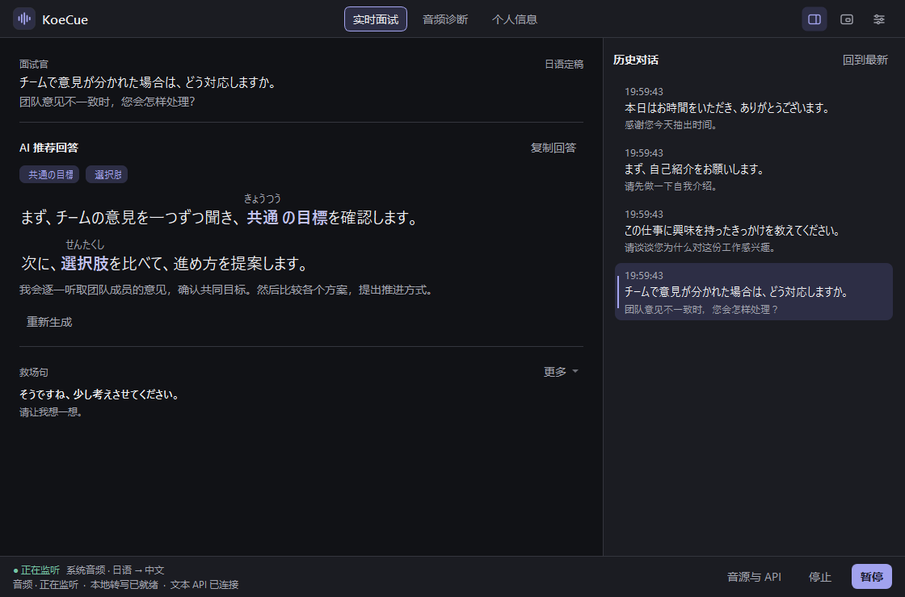
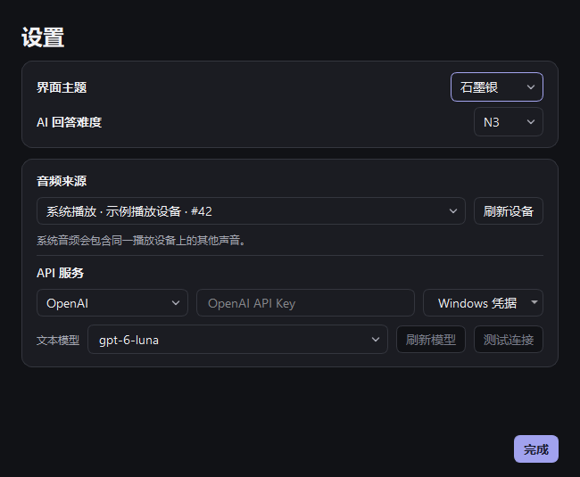

# KoeCue

**实时面试字幕与口述建议。** 支持中文、日语和英语预设，可分别选择识别语言、字幕译文和 AI 回答的语言。适合模拟面试及已获必要同意的线上面试。

**Windows 11 x64** · **可选语音识别模型** · **[MIT License](LICENSE)**

[下载 Windows ZIP](https://github.com/back2era/KoeCue/releases) · [首次使用](#首次使用) · [支持的 API](#支持的-api) · [源码运行与打包](#源码运行与打包)



*日语模式界面示例。字幕和回答为演示内容。*

## 下载并打开

1. 到 [GitHub Releases](https://github.com/back2era/KoeCue/releases) 下载 **`KoeCue-0.0.1.zip`**。
2. 在 Windows 文件资源管理器中右键 ZIP，选择「全部解压缩」。
3. 打开解压后的 `KoeCue` 文件夹，双击 **`KoeCue.exe`**。

GitHub 已发布的 0.0.1 ZIP 对应早期日语版，内含 Whisper。中、日、英三语面试和独立的语音识别模型选择可通过当前源码运行。当前源码的新构建只带运行库，解压后请保留同目录的 `_internal` 文件夹。

## 首次使用

1. **设置语言和回答模型。** 在「实时面试 → 设置」选择面试语言和 AI 回答模型，填好文本 API Key。点「测试文本 API」检查回答和翻译的连接。然后打开「语音识别」，选本地或云端模型，点「使用此模型」。
2. **选择音源。** 要听会议声音，选择 Teams、Zoom 或浏览器正在使用的**系统播放设备**。用自己的声音练习时，选择麦克风。可先去「音频诊断」确认电平有变化。
3. **开始监听。** 确认已取得必要同意，点「完成」保存设置，再在主界面点开始。日语和英语预设默认显示中文字幕，中文预设直接生成中文建议。翻译语言与回答语言不同时，回答也会附上所选语言的译文。选择分段转写时，停顿后才显示原文。切换语言或模型前请先停止监听，已有会话记录按当时的语言组合显示。
4. **回看或复制。** 点击右侧历史中的某一段，可回看字幕和对应建议。点「回到最新」继续跟随实时内容，点「复制回答」可复制该段的 Markdown。使用完毕后点「停止」。

<details>
<summary>查看 0.0.1 版设置界面</summary>



</details>

在「个人信息」按栏目填写基本资料、教育、求职目标和项目或实习经历，也可以点「导入简历」，从带文字层的 PDF、DOCX 或 TXT 本机提取能识别的字段。可以从已有的简历原文重新填充，也可以逐条编辑和添加。导入会保留已填写的字段，核对后点「保存个人信息」。扫描版 PDF 可先转为可复制文本再粘贴。确认开始监听后，KoeCue 会自动用已保存的资料生成建议，并按问题挑选相关片段。以电源研发面试为例，应聘岗位和相关项目会帮助模型理解 DCM、CCM 等缩写。自我介绍和学历题会优先选取学校与专业。资料不足时，学历、经历等问题仍可给待填模板。

回答建议会参考本次会话的最近三段定稿转写，暂停后恢复仍属同一场面试。回答和译文以粗体排版，支持 Markdown 分点。在「实时面试 → 设置」可以调整日语难度、自动回答，并关闭「显示日语回答标注」。关闭后隐藏读音、英文原词和重点颜色。

## 支持的 API

### 语音识别

| 可选模型 | 出字方式与语种 | Key 环境变量 |
| --- | --- | --- |
| [豆包 2.0](https://docs.volcengine.com/docs/doubao-voice/large-model-streaming-automatic-speech-recognition-api-1?lang=zh) | 中文、英语双向实时，使用新版豆包语音控制台小时版 | `DOUBAO_ASR_API_KEY` |
| [Qwen-Audio 3.1 / 3.0 Streaming](https://help.aliyun.com/zh/model-studio/real-time-speech-recognition-user-guide) | 中文、日语、英语双向实时，使用百炼北京地域 Key | `DASHSCOPE_API_KEY` |
| [OpenAI GPT-Live-Transcribe](https://developers.openai.com/api/docs/guides/realtime-transcription) | 中文、日语、英语实时 | `OPENAI_API_KEY` |
| [DeepSeek 语音识别](https://api-docs.deepseek.com/zh-cn/guides/asr/) | 中文、日语、英语，停顿后提交一段 | `DEEPSEEK_API_KEY` |
| [本地 SenseVoice](https://k2-fsa.github.io/sherpa/onnx/sense-voice/index.html) | 中文、日语、英语。本机生成字幕，Small INT8 约 240 MB，Small FP32 约 938 MB | 无 |
| [本地 Qwen3-ASR](https://k2-fsa.github.io/sherpa/onnx/qwen3-asr/pretrained.html) | 中文、日语、英语。本机生成字幕，0.6B INT8 约 987 MB，1.7B INT8 约 2.40 GB | 无 |
| [本地 Whisper](https://huggingface.co/csukuangfj/sherpa-onnx-whisper-base) | 中文、日语、英语。本机生成字幕，Base INT8 约 161 MB | 无 |

选本地模型后，先选版本，再点「下载」。下载并校验完成后点「使用此模型」。模型默认放在 `%LOCALAPPDATA%\AIJapaneseInterviewAssistant\models`，C 盘空间不足可以先点「更改目录」选 E 盘。下载只在手动点击时开始，切换目录后会从新目录查找模型。模型和目录会在下次启动时恢复。本地转写无需语音 Key，字幕翻译和 AI 回答继续使用所选文本 API。

选云端模型并启用后，在「语音识别」页填写所需的语音 Key。用豆包转写、DeepSeek 回答时，另填豆包语音 Key。同一家服务商的转写和回答共用一个 Key。云端转写会发送所选音源的音频，并按服务商规则计费。

### AI 回答与翻译

翻译和回答共用所选文本模型，模型可从预设中选择或手动输入 ID。

| 服务商 | 默认文本模型 | Key 环境变量 |
| --- | --- | --- |
| [OpenAI](https://developers.openai.com/api/docs/models) | `gpt-6-luna` | `OPENAI_API_KEY` |
| [DeepSeek](https://api-docs.deepseek.com/) | `deepseek-flash` | `DEEPSEEK_API_KEY` |
| [Anthropic](https://platform.claude.com/docs/en/api/overview) | `claude-haiku-5-5` | `ANTHROPIC_API_KEY` |
| [千问 · 阿里云百炼](https://help.aliyun.com/zh/model-studio/compatibility-of-openai-with-dashscope) | `qwen3.8-flash` | `DASHSCOPE_API_KEY` |
| [Kimi · 月之暗面](https://platform.kimi.com/docs/api/chat) | `kimi-k3.1-pro` | `MOONSHOT_API_KEY` |
| [GLM · 智谱](https://docs.bigmodel.cn/cn/guide/start/quick-start) | `glm-5.3` | `ZHIPUAI_API_KEY` |
| [MiniMax](https://platform.minimax.cn/docs/api-reference/text-openai-api) | `MiniMax-M3.1-Flash` | `MINIMAX_API_KEY` |
| [Google Gemini](https://aistudio.google.com/docs/openai) | `gemini-3.8-flash` | `GEMINI_API_KEY` |

字幕翻译和 AI 回答都需要网络，具体模型取决于 API 账户权限和服务地区。若翻译语言和识别语言相同，会跳过字幕翻译。

## 常见问题

- **会议有声音，字幕没有出现。** 到「音频诊断」确认电平，并核对会议软件输出设备。系统音频采集的是该播放设备的混音，包括经过同一设备的其他声音。
- **只有 DeepSeek 或千问的 Key。** 可分别选 DeepSeek 分段转写或千问实时转写，并与同一家服务商的回答模型共用 Key。千问语音使用百炼北京地域 Key。
- **API 提示权限、模型或额度问题。** 核对报错来自语音识别还是 AI 回答，再检查对应服务商的 Key、模型权限和额度。
- **暂停后无法点「生成回答」。** 点「恢复」，选中该段历史，再重试。草稿核验失败或内容不完整时，应用会尝试重写。

## 隐私与发布状态

音频和会话历史默认只在内存中。个人资料和设置保存在 `%LOCALAPPDATA%\AIJapaneseInterviewAssistant`，Key 按服务商分别存入 Windows 凭据管理器。确认开始监听后，应用才采集音频。开始前可在设置底部或开始按钮的提示中查看音频和文字的去向。生成回答时会将本次会话的近期转写和与问题相关的资料发送给所选文本 API。保存资料时不会发送请求。服务商的数据保留规则取决于所用 API 和账户配置。

| 状态 | 范围 |
| --- | --- |
| 已完成 | Windows 便携构建、独立语音识别页、SenseVoice、Qwen3-ASR 与 Whisper 按需下载、中日英字幕与回答语言组合、历史记录、回答 Markdown 排版与会话内追问、五套主题和八家文本 API 适配 |
| 待验证 | 各服务商真实 API、实际会议采集、30 分钟联调、端到端延迟和无 Python 的干净 Windows 11 |
| 后续 | 按应用独立采集、根据对话自动切换识别和回答语言 |

Windows 11 x64 的 211 项离线测试通过。SenseVoice INT8 和 Qwen3-ASR 0.6B 已验证下载校验及公开日语样音转写。Whisper Base INT8 已验证在软件内下载、启用及中、日、英公开样音转写。便携构建通过窗口启动、音源枚举和 sherpa-onnx 加载检查。SenseVoice FP32、Qwen3-ASR 1.7B 及各云端识别服务的实际速度和准确率待测试。

## 源码运行与打包

<details>
<summary>开发者命令与验证</summary>

以下命令在 GitHub 源码目录执行。请使用 Windows 11 x64 和 Python 3.13 x64。

```powershell
py -3.13 -m venv .venv
.\.venv\Scripts\python.exe -m pip install -r requirements.txt
.\.venv\Scripts\python.exe -m ai_japanese_interview_assistant
```

源码和当前便携构建均可在「语音识别」页下载 Whisper Base INT8。已能使用旧版 faster-whisper 的源码环境可以继续使用旧模型，也可以在同一页下载新版。

打包脚本会构建 Windows 窗口程序，验证可启动、可枚举设备、支持云端选项并可加载 sherpa-onnx 运行库，再输出 `dist/KoeCue-0.0.1.zip`。本地模型权重由用户在软件中按需下载。

```powershell
.\.venv\Scripts\python.exe -m pip install -r requirements-build.txt
.\.venv\Scripts\python.exe -m scripts.build_windows
```

```powershell
.\.venv\Scripts\python.exe -m pip install -r requirements-dev.txt
$env:AIJA_TEST_GUI = '1'
$env:AIJA_TEST_DEVICES = '1'
.\.venv\Scripts\python.exe -m pytest -q
```

常规测试使用协议替身。真实 API 验收需显式运行，准备对应服务商的环境变量，并只使用授权的文本或音频。

```powershell
.\.venv\Scripts\python.exe -m ai_japanese_interview_assistant.validate_text --provider deepseek --question 'チームで意見が分かれた場合、どうしますか。' --send-authorized-text
```

阶段验收见 [开发计划](docs/superpowers/plans/2026-11-10-koecue.md)。

</details>

## 许可证

KoeCue 源码使用 [MIT License](LICENSE)。随包运行库与可选本地组件的许可证和源码链接见 [第三方组件说明](THIRD_PARTY_NOTICES.md)。
