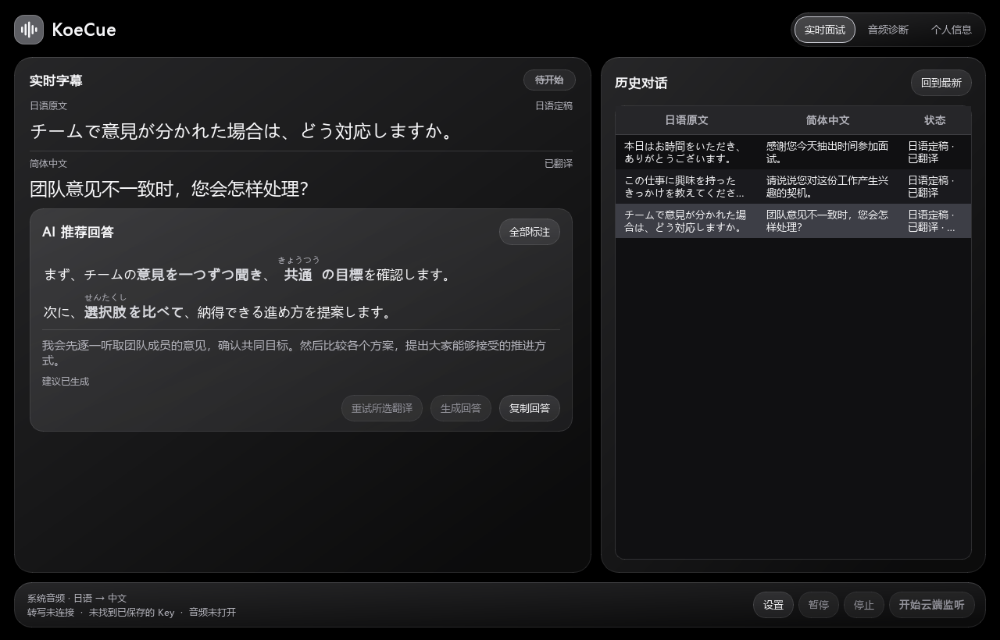
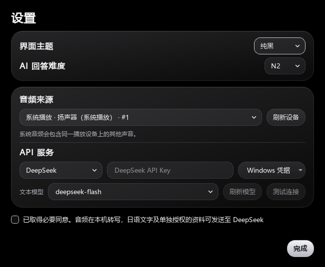

# KoeCue

**实时日语字幕、简体中文翻译和双语口述建议。** 适合日语模拟面试，以及已获必要同意的线上面试。

**Windows 11 x64** · **内置日语语音模型** · **[MIT License](LICENSE)**

[下载 Windows ZIP](https://github.com/back2era/KoeCue/releases) · [首次使用](#首次使用) · [支持的 API](#支持的-api) · [源码运行与打包](#源码运行与打包)



*界面示例。字幕和回答为演示内容。*

## 下载并打开

1. 到 [GitHub Releases](https://github.com/back2era/KoeCue/releases) 下载 **`KoeCue-0.0.1.zip`**。
2. 在 Windows 文件资源管理器中右键 ZIP，选择「全部解压缩」。
3. 打开解压后的 `KoeCue` 文件夹，双击 **`KoeCue.exe`**。

ZIP 已包含运行库和 Whisper 模型。无需安装 Python、输入 PowerShell 命令或另行下载语音模型。请保留同目录的 `_internal` 和 `models` 文件夹。

## 首次使用

1. **设置 API。** 打开「实时面试 → 设置」，选择服务商、填写自己的 API Key，保留默认模型或选择其他模型。点「测试连接」可用一条固定日语短句确认文本 API。
2. **选择音源。** 要听会议里的日语，选择 Teams、Zoom 或浏览器正在使用的**系统播放设备**。用自己的声音练习时，选择麦克风。可先去「音频诊断」确认电平有变化。
3. **开始监听。** 确认已取得必要同意，点「完成」保存设置，再点击「开始本地转写」或「开始云端监听」。说话时先显示日语字幕，断句后逐字显示中文，并自动生成双语回答建议。
4. **回看或复制。** 点击右侧历史中的某一段，可回看字幕和对应建议。点「回到最新」继续跟随实时内容，点「复制回答」可复制日中两种文本。使用完毕后点「停止」。

<details>
<summary>查看设置界面</summary>



</details>

想让回答结合自己的经历时，在「个人信息」填写背景或导入中文、日文、英文简历，点「保存个人信息」，再授权本次要分享的条目。可在设置中选择 N5–N1 的日语难度。资料不足时，学历、经历等问题可以给待填模板。

## 支持的 API

只需要所选服务商的 API Key。翻译和回答共用所选文本模型，模型可从预设中选择或手动输入 ID。

| 服务商 | 默认文本模型 | Key 环境变量 |
| --- | --- | --- |
| [OpenAI](https://developers.openai.com/api/docs/models) | `gpt-6-luna` | `OPENAI_API_KEY` |
| [DeepSeek](https://api-docs.deepseek.com/) | `deepseek-flash` | `DEEPSEEK_API_KEY` |
| [Anthropic](https://platform.claude.com/docs/en/api/overview) | `claude-haiku-5-5` | `ANTHROPIC_API_KEY` |
| [千问 · 阿里云百炼](https://help.aliyun.com/zh/model-studio/compatibility-of-openai-with-dashscope) | `qwen3.8-flash` | `DASHSCOPE_API_KEY` |
| [Kimi · 月之暗面](https://platform.kimi.com/docs/api/chat) | `kimi-k3.1-pro` | `MOONSHOT_API_KEY` |
| [GLM · 智谱](https://docs.bigmodel.cn/cn/guide/start/quick-start) | `glm-5.3` | `ZHIPUAI_API_KEY` |
| [MiniMax](https://platform.minimax.cn/docs/api-reference/text-openai-api) | `MiniMax-M3.1-Flash` | `MINIMAX_API_KEY` |
| [Google Gemini](https://aistudio.google.com/docs/openai) | `gemini-3.8-flash` | `GEMINI_API_KEY` |

**OpenAI** 使用云端语音转写。**其他服务商**使用 ZIP 内置的 Whisper 在本机转写，只将日语文本和单独授权的资料发送给所选服务商。翻译和回答需要网络，具体模型取决于 API 账户权限和服务地区。

## 常见问题

- **会议有声音，字幕没有出现。** 到「音频诊断」确认电平，并核对会议软件输出设备。系统音频采集的是该播放设备的混音，包括经过同一设备的其他声音。
- **只有 DeepSeek 或千问的 Key。** 选择对应服务商即可用本地 Whisper。千问使用中国内地百炼 Key，北京业务空间 ID 可选。
- **连接测试提示权限、模型或额度问题。** 核对当前服务商、Key 和模型 ID，再查账户是否开通对应 API 和额度。
- **暂停后无法点「生成回答」。** 点「恢复」，选中该段历史，再重试。草稿核验失败或缺少一种语言时，应用会自动重写一次。

## 隐私与发布状态

音频和会话历史默认只在内存中。个人资料和设置保存在 `%LOCALAPPDATA%\AIJapaneseInterviewAssistant`，Key 按服务商分别存入 Windows 凭据管理器。只在确认同意并开始监听后采集音频。服务商的数据保留规则取决于所用 API 和账户配置。

| 状态 | 范围 |
| --- | --- |
| 已完成 | Windows 便携打包、本地 Whisper、实时日中字幕、历史与双语建议、五套主题和八家文本 API 适配 |
| 待验证 | 各服务商真实 API、实际会议采集、30 分钟联调、端到端延迟和无 Python 的干净 Windows 11 |
| 后续 | 按应用独立采集 |

Windows 11 x64 离线回归共 162 项通过，覆盖真实设备枚举、界面、字幕、回答核验和 API 协议替身。

## 源码运行与打包

<details>
<summary>开发者命令与验证</summary>

以下命令在 GitHub 源码目录执行。请使用 Windows 11 x64 和 Python 3.13 x64。

```powershell
py -3.13 -m venv .venv
.\.venv\Scripts\python.exe -m pip install -r requirements-local.txt
.\.venv\Scripts\python.exe -m ai_japanese_interview_assistant.local_asr --download-model
.\.venv\Scripts\python.exe -m ai_japanese_interview_assistant
```

打包脚本从本机缓存读取并校验固定修订的 Whisper 模型，也可用 `--model-dir` 指定目录。它会构建 Windows 窗口程序，运行本地启动、设备枚举和 Whisper 推理检查，再输出 `dist/KoeCue-0.0.1.zip`。

```powershell
.\.venv\Scripts\python.exe -m pip install -r requirements-build.txt
.\.venv\Scripts\python.exe -m scripts.build_windows
```

```powershell
.\.venv\Scripts\python.exe -m pip install -r requirements-dev.txt
$env:AIJA_TEST_GUI = '1'
$env:AIJA_TEST_DEVICES = '1'
.\.venv\Scripts\python.exe -m pytest -q
```

常规测试使用协议替身。真实 API 验收需显式运行，准备对应服务商的环境变量，并只使用授权的文本或音频。

```powershell
.\.venv\Scripts\python.exe -m ai_japanese_interview_assistant.validate_text --provider deepseek --question 'チームで意見が分かれた場合、どうしますか。' --send-authorized-text
```

阶段验收见 [开发计划](docs/superpowers/plans/2026-11-10-koecue.md)。

</details>

## 许可证

KoeCue 源码使用 [MIT License](LICENSE)。随包运行库和 Whisper 模型的许可证及源码链接见 [第三方组件说明](THIRD_PARTY_NOTICES.md)。
