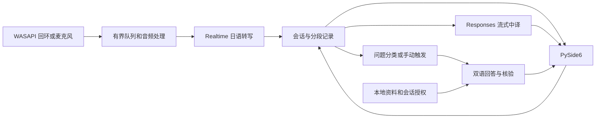

# AI Japanese Interview Assistant 开发计划

在 Windows 11 x64 上，以 Python 3.13、PySide6、PyAudioWPatch 和 OpenAI API 交付日语面试辅助应用。使用方式和实测记录见 [README](../../../README.md)。协作边界见 [AGENTS.md](../../../AGENTS.md)。

## 架构决策

| 方案 | 取舍 |
| --- | --- |
| Python + PySide6 + PyAudioWPatch + OpenAI | 采用。熟悉的语言，音频和 API 可以分阶段验证。先检查设备路由和驱动。 |
| C# + WPF + NAudio + OpenAI | Windows 设备通知更直接，同时引入 C# 和 XAML。遇到 Python 音频封装无法处理的设备行为时用于对照。 |
| Python + 本地语音和文本模型 | 数据留在本机，需分发模型并在目标电脑重新验证速度和质量。 |

WASAPI 回环读取所选设备的共享播放混音。首版一次使用一个回环或麦克风输入。按进程采集是后续扩展。 [WASAPI 回环](https://learn.microsoft.com/windows/win32/coreaudio/loopback-recording) · [按进程采集](https://learn.microsoft.com/en-us/samples/microsoft/windows-classic-samples/applicationloopbackaudio-sample/)

Qt 主线程管理视图。音频原生格式在后台混为单声道，用 SoXR 转为 24 kHz PCM16，并以 16 kHz、20 ms 帧做 WebRTC VAD。预留 200 ms，尾静音 600 ms，语段最长 20 秒。使用 `gpt-live-transcribe` 的客户端提交模式，按会话与 `item_id` 处理增量、定稿及乱序。`gpt-6-luna` 从最终日语段流式生成中译，另做分类、回答和核验。 [Realtime 转写](https://developers.openai.com/api/docs/guides/realtime-transcription) · [Responses 流式事件](https://developers.openai.com/api/docs/guides/streaming-responses)

自动回答默认关闭，每个最终段最多自动触发一次。日语使用 N3–N2 敬体，口述 20–40 秒。每题最多发送两条会话内授权的资料。按 ID 核对后从本地双语资料原样插入个人事实，额外检查模型生成的衔接句。JSON 在 `%LOCALAPPDATA%` 下原子保存。凭据可选用 Windows 凭据管理器。音频和对话在内存中，滚动日志只保留状态、错误分类和时序。Responses 使用 `store=false`，服务端保留按账户规则处理。 [OpenAI 数据控制](https://developers.openai.com/api/docs/guides/your-data)

## 阶段与验收

| 阶段 | 入口和验收 |
| --- | --- |
| 0 文档 | README、AGENTS 和本计划互链，准确标记进度。 |
| 1 诊断 | 无 Key 运行。用浏览器、Teams、Zoom 测试通话及麦克风确认电平，检查静音、错误路由、USB、蓝牙和 20 次开始/暂停/恢复/停止。暂停后计数停止，退出时释放设备。 |
| 2 转写 | 用明确授权的实时节奏 WAV 或回环，验证较长语段说完前出现增量、停顿后定稿、连续讲话、静音、乱序、无效 Key 和断网。 |
| 3 双语界面 | 同卡片展示原文和流式中文，验证历史、翻译重试以及断网时界面可操作。 |
| 4 回答 | 无采音，用至少 30 条标注日语测试分类。问题召回至少 90%，非问题最多误触发一条。人工朗读 10 条回答，至少 8 条在 20–40 秒，并确认双语和复制。 |
| 5 资料 | 独立资料编辑页，验证增删改、重启读取、空资料、撤销分享、未知事实、损坏 JSON 和诱导编造。核对实际请求和回答事实。 |
| 6 联调 | 从干净 Windows 环境按 README 运行，验证锁定依赖、离线 pytest、30 分钟运行、断网、限流、拔插及退出。检查敏感内容未写盘，真实 API 单独验收。 |

以至少 30 段录音记录设备、网络、模型与 p50/p95。目标 p95 为开口到日语增量 2.5 秒、语段结束到中文增量 3 秒、问题定稿到可复制回答 10 秒。
